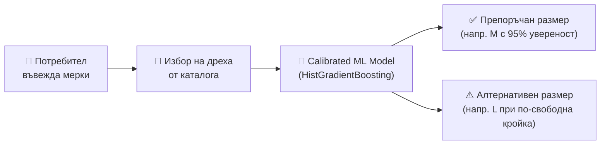

<h1 align="center">🧥 SmartFit</h1>
<p align="center">
  
</p>
<p align="center">
  <em>Иновативна система за интелигентна препоръка на размер при онлайн пазаруване</em>
</p>

---

## 🔍 За какво служи проектът?

**SmartFit** е интелигентна система, която използва алгоритми за машинно обучение (Machine Learning), за да предложи най-подходящия размер дреха на база на:

- **Телесни мерки на потребителя**: ръст, тегло, талия, гръдна обиколка, тип тяло и пол
- **Характеристики на дрехата**: вид дреха (риза, панталон, рокля, яке и др.), материя (еластичност) и ширина на дрехата (`garment_width`)

🎯 **Край на грешните размери и безкрайните връщания на поръчки!**

---

## 🧠 Как работи системата?



1. Потребителят въвежда телесните си мерки (ръст, тегло, талия, гръдна обиколка).
2. Избира модел от каталога с дрехи.
3. Моделът за машинно обучение анализира мерките в комбинация с ширината и еластичността на избраната дреха.
4. Връща персонализирана препоръка с изчислено ниво на увереност (Confidence Score) и алтернативен съседен размер при гранични случаи.

---

## 🛠️ Технологичен стек

| Категория | Технологии |
| :--- | :--- |
| **Backend** | Python 3.12 / 3.13, Flask 3, Flask-Login, Flask-Mail, Flask-CORS, Flask-Migrate |
| **Machine Learning** | Scikit-Learn (`HistGradientBoostingClassifier`, `RandomForestClassifier`), `CalibratedClassifierCV`, Pandas, NumPy |
| **Database** | SQLite, SQLAlchemy 2.0 (ORM) |
| **Frontend** | React 18, TypeScript, Tailwind CSS, Vite, Radix UI (shadcn), Lucide Icons |
| **Тестване (QA)** | Python `unittest` (10 автоматизирани теста за автентикация, каталог и ML) |
| **Логване и мониторинг** | Многоканална ротационна система за логове (`RotatingFileHandler`), аналитичен модул `analyze_logs.py` |

---

## 🔑 Роли в системата

- 👤 **Потребител (User)**: Въвежда и редактира мерки, получава AI препоръки, разглежда каталога и оставя коментари за дрехи, за които е получил препоръка.
- 🧵 **Търговец / Продавач (Seller)**: Добавя нови обяви за дрехи през специализиран панел с модална форма, управлява и изтрива своите обяви.
- 🛡️ **Администратор (Admin)**: Достъп до пълно табло с аналитики, брой потребители, обяви, препоръки и възможност за управление на съдържанието.

---

## 💻 Инструкции за стартиране на проекта

### 1️⃣ Клониране на хранилището

```bash
git clone https://github.com/YourUsername/SmartFit.git
cd SmartFit
```

---

### 2️⃣ Създаване и активиране на виртуална среда (venv)

#### macOS / Linux:
```bash
python3 -m venv venv
source venv/bin/activate
```

#### Windows:
```cmd
python -m venv venv
venv\Scripts\activate.bat
# или в PowerShell:
# venv\Scripts\Activate.ps1
```

---

### 3️⃣ Инсталиране на зависимостите

```bash
pip install -r requirements.txt
```

---

### 4️⃣ Стартиране на тестовете

За да се уверите, че всичко работи изправно (сигурност, API маршрути, ML модел):

```bash
python -m unittest discover tests
```

---

### 5️⃣ Стартиране на сървърите

#### Бекенд (Flask API на порт 5001):
```bash
python app.py
```

#### Фронтенд (React на порт 8080):
```bash
cd PresentationLayer
npm install
npm run dev
```

Отворете [http://localhost:8080](http://localhost:8080) в браузъра.

---

## 🔬 Машинно обучение и EDA (CRISP-DM Архитектура)

Проектът разполага с напълно отделен и структуриран MLOps пайплайн (`ml_pipeline/`):

1. **Цялостно автоматизирано изпълнение (Data Prep -> EDA -> Training -> Model Registry)**:
   ```bash
   python ml_pipeline/pipeline.py
   ```

2. **Изпълнение по фази съгласно CRISP-DM**:
   - **Data Preparation (Генериране на данни):**
     ```bash
     python ml_pipeline/data_preparation/generate_dataset.py
     # Записва ml_pipeline/data/processed/training_data.csv (6,000 записа)
     ```
   - **Data Understanding (EDA анализ):**
     ```bash
     python ml_pipeline/data_understanding/eda_analysis.py
     # Записва ml_pipeline/data_understanding/EDA_REPORT.md
     ```
   - **Training & Model Registry (Обучение и калибриране):**
     ```bash
     python ml_pipeline/training/train_model.py
     # Сравнява Logistic Regression, Random Forest и HistGradientBoosting
     # Записва оценката в ml_pipeline/training/model_evaluation.txt
     # Експортира готовия модел в ml_pipeline/models/smartfit_model.pkl
     ```

---

## 📁 Структура на проекта

```
SmartFit/
├── app/                              # Flask REST API Backend
│   ├── __init__.py                   # Application Factory (create_app)
│   ├── models.py                     # SQLAlchemy модели (User, Clothing, RecommendationHistory, Comment)
│   ├── logging_config.py             # Логинг архитектура
│   ├── seed.py                       # Начални данни (Admin, Продавачи, Каталог)
│   ├── decorators.py                 # Ролеви декоратори (@seller_required, @admin_required)
│   ├── services/                     # Сървизен слой
│   │   ├── __init__.py
│   │   └── recommendation_service.py # Онлайн ML инференция в реално време
│   ├── ml/
│   │   └── ml_model.py               # Обратно-съвместим мостов модул
│   └── routes/                       # API Blueprints (auth, clothing, users, admin, comments)
│
├── ml_pipeline/                      # CRISP-DM Machine Learning Pipeline
│   ├── data/
│   │   ├── raw/                      # Референтни стандарти (ISO 8559, EN 13402)
│   │   └── processed/                # Валидиран тренировъчен дейтасет (training_data.csv)
│   ├── data_understanding/           # EDA статистика и аналитичен доклад (EDA_REPORT.md)
│   ├── data_preparation/             # Генератор на данни (generate_dataset.py)
│   ├── training/                     # Обучение, калибрация и метрики (train_model.py)
│   ├── models/                       # Model Registry (smartfit_model.pkl)
│   ├── pipeline.py                   # Главен оркестратор
│   └── README.md                     # Документация на ML процеса
│
├── PresentationLayer/                # SPA Frontend (React + TypeScript + Vite + Tailwind)
│   ├── src/pages/                    # Основни страници (Catalog, Recommendations, SellerListings, Admin)
│   ├── src/components/               # UI Компоненти (ClothingCard, Dialog, Navbar, Forms)
│   └── src/services/                 # API клиенти (authService, measurementsService)
│
├── tests/                            # Автоматизирани тестове (unittest)
│   ├── test_auth.py                  # Тестове за регистрация, вход и JWT
│   ├── test_clothes.py               # Тестове за CRUD операции с дрехи
│   ├── test_ml.py                    # Тестове за модела и инференцията
│   └── test_admin.py                 # Тестове за администраторски права
│
├── Dockerfile & docker-compose.yml   # Контейнеризация
├── requirements.txt                  # Python зависимости
└── app.py                            # Входна точка за стартиране на бекенда
```
│   └── routes/
│       ├── auth_routes.py    # Регистрация, вход, токени
│       ├── user_routes.py    # Потребителски профил и мерки
│       ├── clothing_routes.py# Каталог, препоръки, продавач CRUD
│       ├── comment_routes.py # Коментари и отзиви
│       └── admin_routes.py   # Административно табло
├── PresentationLayer/        # React + TypeScript + Vite + Tailwind фронтенд
│   ├── src/
│   │   ├── components/       # UI компоненти
│   │   ├── pages/            # Страници (Каталог, Препоръка, Продавач, Админ)
│   │   ├── store/            # Zustand глобален стейт (authStore)
│   │   └── types/            # TypeScript дефиниции
│   └── package.json
├── tests/                    # Автоматизирани тестове
│   ├── test_auth.py          # Тестове за автентикация и сигурност
│   ├── test_clothes.py       # Тестове за каталога и продавачи
│   └── test_ml.py            # Тестове за предсказване на размер
├── instance/                 # База данни (SQLite) и структурирани логове
├── analyze_logs.py           # Анализатор на системните логове
├── app.py                    # Входна точка за бекенда
├── requirements.txt
└── README.md
```

---

## ✨ Автор

👩 **Филипа Попова** — Софтуерен разработчик, 11 "б" клас  
📧 fhpopova21@codingburgas.bg
